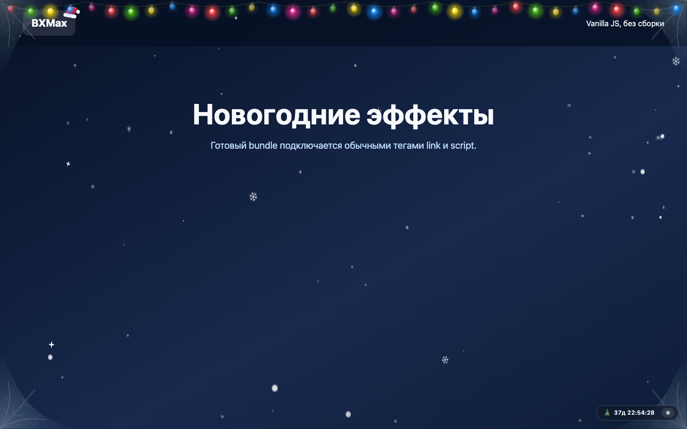

# Новогодние эффекты для 1С-Битрикс

Модуль `newyear.effects` добавляет на публичные страницы снег, гирлянду, украшения, морозный узор и новогодний виджет. Все эффекты настраиваются в административной части. Модуль умеет работать по календарю, исключать отдельные URL и снижать нагрузку на слабых устройствах.



## Возможности

- Canvas-снег с настройкой интенсивности, скорости, размера, ветра, глубины и цвета.
- Гирлянда для выбранных CSS-селекторов: пять режимов анимации, готовые палитры и свои цвета.
- Векторные украшения для логотипа или другого элемента страницы.
- Морозный узор, искры, обратный отсчёт и праздничный салют.
- Годовое расписание, включая диапазон через границу года.
- Маски исключённых URL.
- Профили производительности `auto`, `high`, `balanced` и `eco`.
- Режимы для мобильных устройств `full`, `eco` и `off`.
- Учёт `prefers-reduced-motion` и пользовательский выключатель эффектов.
- Русский и английский интерфейс.

## Требования

- 1С-Битрикс: Управление сайтом с модулем `main` версии 23.0 или новее.
- PHP 8.2 или новее.
- Современный браузер с Canvas, SVG и `requestAnimationFrame`.
- Node.js 22 или новее нужен только для разработки.

Для установки модуля Node.js не нужен. Готовые JS- и CSS-файлы лежат в `dist/` и входят в репозиторий.

На `main` 26.600 и новее установщик использует декларативные миграции. На версиях `main` 23.0–26.599 событие регистрируется через `EventManager`.

## Установка

1. Скопируйте каталог модуля в `/local/modules/newyear.effects/`.
2. Откройте `/bitrix/admin/partner_modules.php?lang=ru`.
3. Найдите «Новогодние эффекты» и нажмите «Установить».
4. Откройте настройки модуля и проверьте CSS-селекторы шапки и логотипа на своём шаблоне.

Установщик копирует JS-расширения в `/local/js/newyear/effects/` и регистрирует обработчик `OnProlog`.

## Два варианта фронтенда

### BX/Vanilla без сборки

Обычная установка использует готовые файлы `dist/`. Битрикс подключает их через `config.php`, поэтому на сервере не нужны npm и Chef.

Тот же bundle работает как обычный Vanilla JS. Пример находится в [`examples/vanilla.html`](examples/vanilla.html): страница подключает CSS, JSON-конфигурацию и один JS-файл. Это подходит для проекта без сборщика или для переноса визуала на сайт без Битрикса.

### Исходники и Chef

Каталог `src/` нужен разработчикам, которые меняют движок. Chef собирает его в те же готовые файлы `dist/`. Пользователь модуля этот шаг не выполняет.

Публичный `engine` намеренно написан на браузерном API: так один bundle работает и в Битриксе, и как Vanilla JS. Расширение `admin` служит адаптером к административной части и проходит правила линтера Bitrix Chef.

## Обновление

Перед обновлением сохраните резервную копию каталога модуля и значений его настроек. Затем замените файлы в `/local/modules/newyear.effects/` и скопируйте содержимое `install/js/` в `/local/js/`.

После обновления очистите управляемый кеш Битрикса и кеш браузера. Проверьте публичную страницу на компьютере и телефоне.

## Настройка

Страница настроек разделена на общие параметры, снег, гирлянду и украшения.

В общих параметрах задаются расписание, исключённые URL, профиль производительности, мобильный режим, морозный узор и виджет. Для ежегодного диапазона используются даты в формате `MM-DD`. Диапазон `12-15` — `01-15` работает через границу года.

CSS-селекторы гирлянды и украшений зависят от шаблона сайта. Значения по умолчанию подходят не для каждого проекта. Если эффект появился не на том элементе, укажите точный селектор шапки или логотипа.

Предпросмотр в административной части не меняет публичную страницу до сохранения формы.
После сохранения модуль очищает композитный кеш, чтобы новые настройки сразу попали в публичный HTML.

## Производительность и анимация

Профиль `auto` измеряет FPS и выбирает подходящую нагрузку. Профили ограничивают плотность снега, коэффициент пикселей Canvas, интерактивность и часть анимаций. На скрытой вкладке снег и гирлянда приостанавливаются.

Мобильный режим `eco` уменьшает число частиц и отключает дорогие эффекты. Режим `off` не запускает движок на мобильном устройстве.

При включённом параметре «Учитывать уменьшение движения» системная настройка `prefers-reduced-motion: reduce` переводит эффекты в статичный режим. Пользователь также может отключить их в виджете. Выбор хранится только в `localStorage` браузера.

## PHP API

Публичный сервис доступен через контейнер Битрикса:

```php
<?php

use Bitrix\Main\DI\ServiceLocator;
use Bitrix\Main\Loader;
use Newyear\Effects\Public\Service\EffectsService;

Loader::requireModule('newyear.effects');

/** @var EffectsService $effects */
$effects = ServiceLocator::getInstance()->get(EffectsService::class);

$config = $effects->getConfig();
$isActive = $effects->shouldRenderOnPath('/catalog/');
$effects->setSnowIntensity(40);
$result = $effects->setEffectEnabled('snow', true);

if (!$result->isSuccess()) {
    // Обработайте ошибки в коде проекта.
}
```

Метод `setEffectEnabled()` принимает `snow`, `garland`, `decorations`, `frost` или `sparkles`. Метод `applyPreset()` принимает `classic`, `minimal`, `nordic`, `festive` или `eco`.

Код проекта отвечает за проверку прав перед вызовом методов, которые меняют настройки.

## Логи

Ошибка инициализации эффекта не прерывает публичную страницу. Обработчик отправляет класс и код исключения в логгер Битрикса с идентификатором `newyear.effects.public`. URL, параметры запроса и содержимое настроек в запись не попадают. Если отдельный логгер не настроен, Битрикс использует стандартный логгер; без него запись пропускается.

## Сборка JS

Проект использует Node.js 22 и `@bitrix/chef` 2.4.0. Установите зависимости и соберите оба расширения:

```bash
npm ci
npm run build
```

Отдельная сборка:

```bash
npm run build:engine
npm run build:admin
npm run lint:admin
```

Скрипт создаёт временную структуру проекта Битрикса, запускает Chef для расширений `newyear.effects.engine` и `newyear.effects.admin`, затем возвращает только готовые `dist/`. Это позволяет собирать отдельный репозиторий модуля без полного ядра Битрикса. После правки `src/` пересоберите `dist/` в том же коммите.

## Тесты

PHP-тесты не требуют установленного Битрикса:

```bash
npm run test:php
```

JS-тесты используют встроенный раннер Node.js:

```bash
npm run test:js
```

Полная локальная проверка:

```bash
npm test
npm run lint:admin
npm run build
```

CI запускает PHP-проверки на 8.2, 8.4 и 8.5, JS-тесты на Node.js 22 и повторную сборку. Если `dist/` отличается от закоммиченной версии, проверка завершается ошибкой.

## Структура

```text
newyear.effects/
├── install/                    установщик, миграции и JS-расширения
│   └── js/newyear/effects/
│       ├── engine/             публичный движок эффектов
│       └── admin/              предпросмотр страницы настроек
├── lang/                       русские и английские фразы
├── lib/
│   ├── Internals/              хранение, нормализация и интеграция с Битриксом
│   └── Public/                 DTO и публичные сервисы
├── examples/vanilla.html       запуск готового bundle без Битрикса и Node.js
├── tests/php/                  изолированные PHP-тесты
├── tools/chef-build.mjs        сборка отдельного репозитория через Chef
├── default_option.php          значения по умолчанию
├── options.php                 страница настроек
└── .settings.php               контейнер сервисов модуля
```

## Лицензия

Код распространяется по лицензии [MIT](LICENSE).
